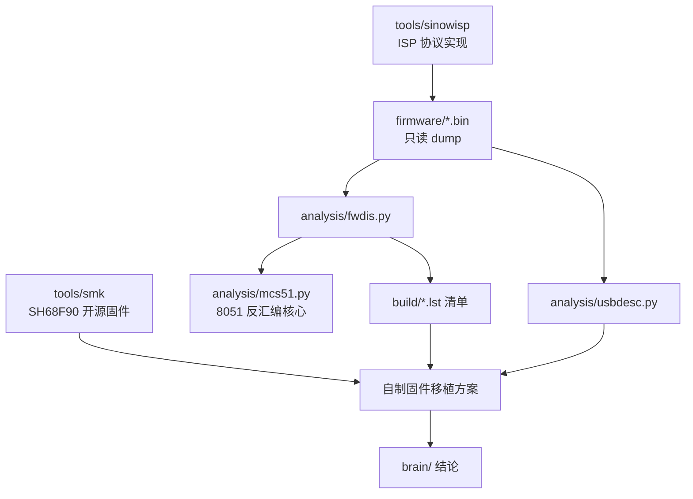

# System architecture

## Overview

本项目不是软件系统，而是**围绕一块硬件板的逆向工程工作台**，分四层：

1. **样本层** — `firmware/` 中的只读 dump（完整 64 KiB、应用 60 KiB、bootloader 4 KiB），
   每个文件都有记录的 MD5，作为一切分析的基准。
2. **工具层** — `analysis/` 下的 Python 工具链（纯标准库）：
   * `mcs51.py`：表驱动的精确 MCS-51 反汇编器，带 SFR/XSFR 命名、标签、Intel HEX 读写；
   * `fwdis.py`：CLI，提供 `info / dis / xref / sfr / xdata / ports / strings / find`；
   * `usbdesc.py`：USB 设备/配置/字符串/HID 报告描述符解析器。
3. **知识层** — `brain/`（本知识库）记录结论；`README.md` 记录可复现的命令。
4. **参考层** — `tools/` 下的第三方代码（`sinowisp` 协议实现、`smk` 开源固件），
   不入库，由 `tools/fetch-tools.ps1` 拉取。

## Module graph

## Constraints

* **禁止写入**：未获明确许可不得执行 flash 写入/擦除。所有流程默认只读。
* **必须可回滚**：任何自制固件方案都必须保留 `LJMP 0xFF00` + `A5/5A` 的 ISP 跳转通道，
  否则一旦写入失败只能开壳用编程器。
* **工具链受限**：目标机无 Python（已用 `uv` 提供）、无 SDCC、无 Nix；
  SMK 官方构建走 Nix flake，Windows 下需要单独准备 SDCC + meson + ninja。
* **分析必须可复现**：所有结论要能由 `firmware/` 中的 dump 加 `analysis/` 中的工具重新推导出来。
