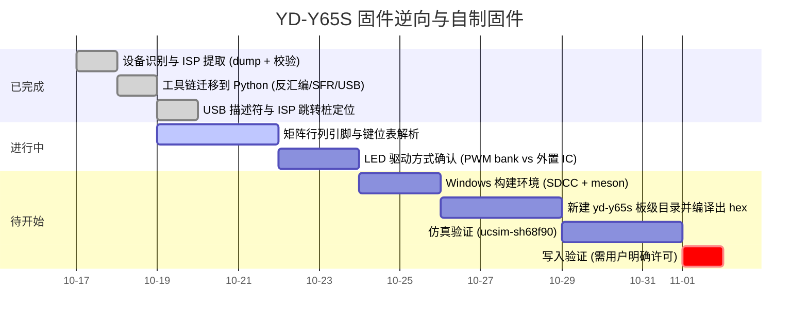

# Roadmap

## Milestones

## 当前状态

* **已完成**：完整 64 KiB dump（MD5 已记录）、bootloader 校验、Python 分析工具链、
  中断向量表、USB 描述符全解、ISP 协议与跳转桩、键位表区域定位。
* **进行中**：矩阵扫描例程 `0x35E8` 的 10 个入口与引脚映射关系；
  `0xBC00-0xCC00` 的 4 字节记录格式。
* **阻塞**：无。
* **红线**：写入验证必须等用户明确许可。
