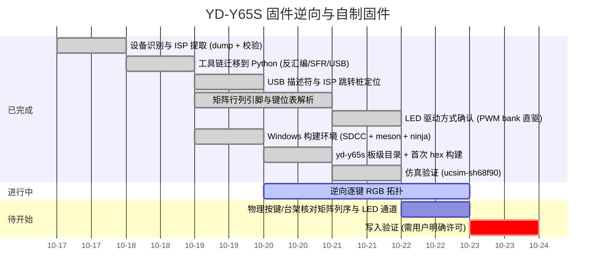

# Roadmap

## Milestones

## 当前状态

* **已完成**：完整 64 KiB dump（MD5 已记录）、bootloader 校验、Python 分析工具链、
  中断向量表、USB 描述符全解、ISP 协议与跳转桩。
  **矩阵几何已确认**（15 列 `P6.0-P6.7/P5.0-P5.2/P5.7/P4.0/P7.7/P4.5` × 5 行
  `P7.1-P7.3/P5.3/P5.4`，`MATRIX_COLS 15` / `MATRIX_ROWS 5`）；**键位表已全解**
  （`0xBC00-0xCC00` 四层 × 0x200，4 字节记录 `[class,mod,hi,usage]`，列优先、slot0 空置，
  每层 +0x400 处有逐字节副本）；**LED 为内置 PWM bank 直驱**（`PWM00CON..PWM30CON` +
  `DUTY=0xB0`/`PERD=0xB0`，15-16 通道）——详见页面 `matrix-and-keymap`。
* **SMK 移植已可编译（2026-10-19）**：`src/keyboards/yd-y65s/` 板级目录 +
  `analysis/gen_smk_layout.py`（从 dump 生成键位）+ `tools/build-port.ps1`
  （SDCC 4.6.0 / meson 1.12.1 / ninja 1.13.2 / gcc 15.2.0 / sinowisp 2.1.0），
  产物 `build/smk-yd-y65s/yd-y65s_default_smk.hex`；CSEG ≈13.7 KiB + CONST ≈1.2 KiB。
  ISP 逃生桩 `75 F0 A5 74 5A 02 FF 00` @ `0x2811` 保留。细节见页面 `smk-port`。
* **仿真验证已通过（2026-10-19）**：WSL 里构建补丁版 uCsim 0.8.15（`tools/build-ucsim.*`），
  `tools/sim-tests.ps1` 跑 29 项全绿——复位→主循环、USB 枚举到 CONFIGURED、描述符/LED/
  idle/protocol、**真实 `isp_jump()` 握手**、中断向量压栈，以及本仓库
  `tests/test_y65s_sim.py` 用 YD-Y65S 列线模型核验的 4 个按键位置（期望值取自 dump）。
* **进行中**：逆向逐键 RGB 拓扑（P4.4/P4.7、P7.4-P7.6 的角色与 Fn 层 `0x08` 子码语义）。
* **阻塞**：无。
* **红线**：写入验证必须等用户明确许可（见 `no-write-policy`）。
* **待证**：扫描列序"从左到右"与 PWM 通道↔物理列的对应为推断，需按键/台架核对；
  仿真只覆盖 MCU 模型 + 测试侧矩阵，未覆盖真实 RGB/RF 硬件与供电差异。
