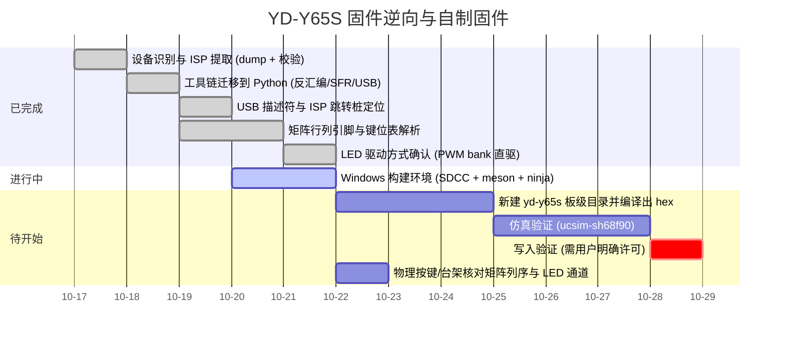

# Roadmap

## Milestones

## 当前状态

* **已完成**：完整 64 KiB dump（MD5 已记录）、bootloader 校验、Python 分析工具链、
  中断向量表、USB 描述符全解、ISP 协议与跳转桩。
  **矩阵几何已确认**（15 列 `P6.0-P6.7/P5.0-P5.2/P5.7/P4.0/P7.7/P4.5` × 5 行
  `P7.1-P7.3/P5.3/P5.4`，`MATRIX_COLS 15` / `MATRIX_ROWS 5`）；**键位表已全解**
  （`0xBC00-0xCC00` 四层 × 0x200，4 字节记录 `[class,mod,hi,usage]`，列优先、slot0 空置，
  每层 +0x400 处有逐字节副本）；**LED 为内置 PWM bank 直驱**（`PWM00CON..PWM30CON` +
  `DUTY=0xB0`/`PERD=0xB0`，15-16 通道）——详见页面 `matrix-and-keymap`。
* **进行中**：Windows 构建环境（SDCC + meson + ninja + `sinowisp`）。
* **阻塞**：无。
* **红线**：写入验证必须等用户明确许可（见 `no-write-policy`）。
* **待证**：扫描列序"从左到右"与 PWM 通道↔物理列的对应为推断，需按键/台架核对；
  class `0x07`/`0x08` 的运行时派发路径尚未完整走通。
