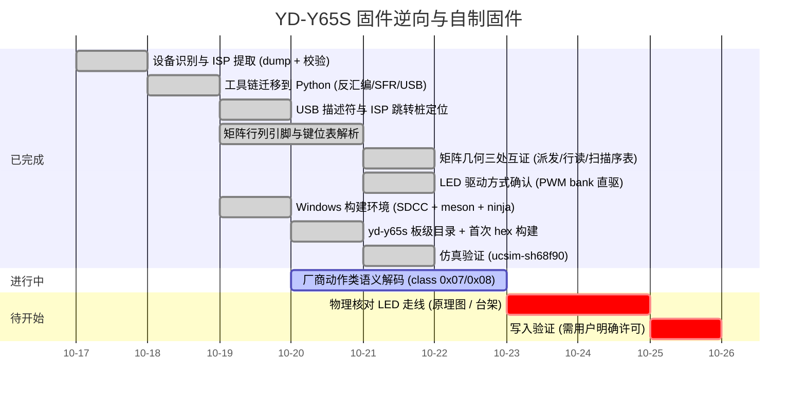

# Roadmap

## Milestones

## 当前状态

* **已完成**：完整 64 KiB dump（MD5 已记录）、bootloader 校验、Python 分析工具链、
  中断向量表、USB 描述符全解、ISP 协议与跳转桩。**键位表已全解**（`0xBC00-0xCC00` 四层 ×
  0x200，4 字节记录 `[class,mod,hi,usage]`，列优先、slot0 空置，每层 +0x400 处有逐字节副本）；
  **LED 为内置 PWM bank 直驱**（`PWM00CON..PWM30CON`，24 路；`DUTY=0xB0`/`PERD=0xB0`）。
* **矩阵几何已确认（2026-10-19）**，且是**从厂商代码直接读出、三处独立互证**，不再是推断：
  ① 扫描派发 `0x35E8` 的处理块按固定次序 `CLR Px.y` 并把结果依次写进 `RAM_2C..RAM_3A`
  （列序 `P6.0-P6.7, P5.0-P5.2, P5.7, P4.0, P7.7, P4.5`）；② 行读取 `0xB130` 的位打包使
  bit0 恒 0、bit(1+k)=物理行 k（`P7.1,P7.2,P7.3,P5.3,P5.4`）；③ 扫描序表 `0x0A90` 用
  `col*8+slot`（未用槽 `0xFF`）编码 90 个可能键位。详见页面 `matrix-and-keymap`。
* **SMK 移植已可编译并可仿真**：`src/keyboards/yd-y65s/` + `analysis/gen_smk_layout.py`
  → `build/smk-yd-y65s/yd-y65s_default_smk.hex`（CSEG ≈13.7 KiB + CONST ≈1.2 KiB）；
  补丁版 uCsim 0.8.15 下 29 项测试全绿，含真实 `isp_jump()` 握手与 YD-Y65S 键位核验。
  细节见页面 `smk-port`。
* **进行中**：厂商动作类语义解码——class `0x07` 的 6 个私有子码（`0x01/05/06/07/08/0A`，
  落在左下 Alt/Cmd 与 Z/X/C/V/G 上）与 class `0x08` 的 8 个 LED 动作（落在 Space/Del/
  PgUp/PgDn/方向键上）。子码全集已枚举，但消费点（flash 键位表 → 运行时代码）尚未找到。
* **阻塞**：PWM 通道 ↔ 物理走线（原理图或台架测量才能定）；无线模块（若确为 BK3632）。
* **红线**：写入验证必须等用户明确许可（见 `no-write-policy`）。
* **待证**：仿真只覆盖 MCU 模型 + 测试侧矩阵，未覆盖真实 RGB/RF 硬件与供电差异；
  物理键盘的"从左到右"朝向未做按键核对（但厂商与移植版用同一 `列序→引脚` 映射与同一按序号
  索引的键位表，同一物理按键在两者中解析为同一键位，因此不影响正确性）。
