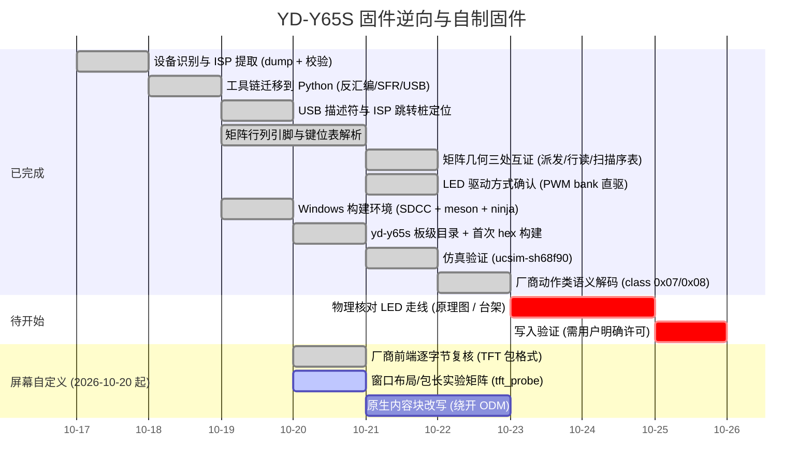

# Roadmap

## Milestones

## 当前状态

* **已完成**：完整 64 KiB dump（MD5 已记录）、bootloader 校验、Python 分析工具链、
  中断向量表、USB 描述符全解、ISP 协议与跳转桩。**键位表已全解**（`0xBC00-0xCC00` 四层 ×
  0x200，4 字节记录 `[class,mod,hi,usage]`，列优先、slot0 空置，每层 +0x400 处有逐字节副本）；
  **LED 为内置 PWM bank 直驱**（`PWM00CON..PWM30CON`，24 路；`DUTY=0xB0`/`PERD=0xB0`）。
* **矩阵几何已确认（2026-10-19）**，且是**从厂商代码直接读出、三处独立互证**，不再是推断：
  ① 扫描派发 `0x35E8` 的处理块按固定次序 `CLR Px.y` 并把结果依次写进 `RAM_2C..RAM_3A`
  （列序 `P6.0-P6.7, P5.0-P5.2, P5.7, P4.0, P7.7, P4.5`）；② 行读取 `0xB130` 的位打包使
  bit0 恒 0、bit(1+k)=物理行 k（`P7.1,P7.2,P7.3,P5.3,P5.4`）；③ 扫描序表 `0x0A90` 用
  `col*8+slot`（未用槽 `0xFF`）编码 90 个可能键位。详见页面 `matrix-and-keymap`。
* **SMK 移植已可编译并可仿真**：`src/keyboards/yd-y65s/` + `analysis/gen_smk_layout.py`
  → `build/smk-yd-y65s/yd-y65s_default_smk.hex`（CSEG ≈13.7 KiB + CONST ≈1.2 KiB）；
  补丁版 uCsim 0.8.15 下 29 项测试全绿，含真实 `isp_jump()` 握手与 YD-Y65S 键位核验。
  细节见页面 `smk-port`。
* **厂商动作类语义已解码（2026-10-20）**：键位表消费链 = 读取器 `0x748F` → 记录副本 `xdata 0x0B91..0x0B94`
  → 两个 class 派发器 `0x27B4`（主）/ `0x25D5`（副），逐键子数组为 `xdata 0x0B0F+21*row+col`。
  **class `0x07`** = 厂商组合键/模式动作；**class `0x08`** = LED/背光控制指令（动作号在 `byte1`、参数在 `byte2`）。
  LED 引擎变量/表确认到一级：`xdata 0x0F65` 灯效索引、`xdata 0x0CA1` 预设号经 code 表 `0xD119` 映射、
  `xdata 0x0CA0` 状态机由 4 分频定时中断 `0x62E0` 驱动。
* **静态分析陷阱**：`analysis/fwdis.py` 的"可达性"输出存在大片 gap，"全固件找不到 X"类结论必须用
  `--start 0 --len 0xF000` 的全量线性反汇编复核。
* **屏幕链路（2026-10-20）**：主机 → 模块的通路已打通（记录 0x0D/0x0C 换背景图、0x04 切页），
  但**自定义图上传失败**、**校时从未成功**。厂商前端已逐字节复核（包格式与我们的实现一致），
  剩余两个未定量：① 每包数据长度 504（0x05 通道）还是 511（0x81 通道）；② 记录数据窗从 `payload[7]` 起，
  上一轮校时把包放在 `payload[0]` 整体错位 7 字节。实验矩阵见页面 `screen-customization`
  与 `tools/tft_probe.py`。
* **阻塞**：PWM 通道 ↔ 物理走线（原理图或台架测量才能定）；无线模块（若确为 BK3632）。
* **红线**：写入验证必须等用户明确许可（见 `no-write-policy`）。
* **待证**：仿真只覆盖 MCU 模型 + 测试侧矩阵，未覆盖真实 RGB/RF 硬件与供电差异；
  `class 0x01/0x02`（`RAM_0x78` / `RAM_0x57,0x58`）的目标语义、`xdata 0x0B8F` 的含义、
  `xdata 0x0BA6`/`0x0B8D` 的最终消费者仍未定位。
