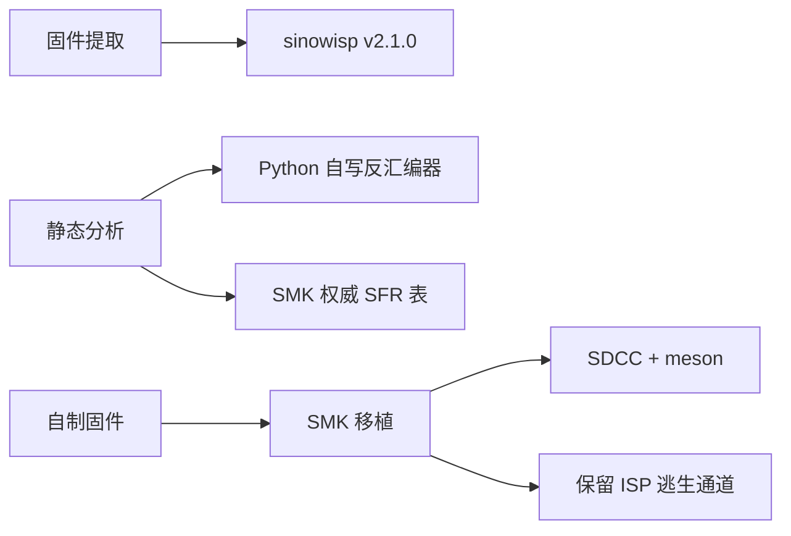

# Tech stack

## Technology choices

| domain | candidates | decision | rationale |
|---|---|---|---|
| 固件提取 | 厂商升级工具 / `sinowisp` / 自写 HID | **`sinowisp` v2.1.0**（官方 Windows 预编译） | 已内置本机设备档案（`superframe-phantom` = `258a:019d`），协议经源码审计，二进制 sha256 与 release digest 一致 |
| 反汇编 | Ghidra 插件 / `dis51` / 自写 | **自写 Python 表驱动反汇编器** | 环境无 Python 时先写了 JS 原型；Python 版可精确控制指令长度、SFR 命名与交叉引用，且能顺手做 ports/xdata 统计 |
| SFR 命名 | 自行猜测 / SMK 逆向结果 | **SMK 的 `sh68f90.h`** | 同一颗芯片的社区逆向成果，含 USB 端点、PWM bank、Flash/ISP 寄存器，避免误命名 |
| 自制固件基座 | QMK 移植 / 从零写 / **SMK** | **`karstx/smk`** | 已支持 SH68F90A + USB HID + 键扫 + LED PWM + ISP 命令，且作者同属 `sinowisp` 生态 |
| 固件编译 | SDCC 直调 / **meson + ninja** | **SDCC + meson + ninja** | 沿用 SMK 的构建体系，减少与上游的差异；Windows 需自行安装 SDCC |
| 分析脚本运行时 | 系统 Python / uv 托管 | **uv 托管的 CPython 3.12+** | 无需管理员权限，`uv run` 直接跑，零第三方依赖 |

## Decision mindmap

## Open items

* Windows 下的 SDCC / meson 安装方式尚未落地（当前仅有 ninja + gcc）。
* Y65S 的矩阵行列引脚尚未从固件中完全确定（`0x35E8` 跳转表已定位，引脚映射待确认）。
* LED 驱动方式（PWM bank 直驱 vs 外置驱动 IC）未定，影响 SMK 移植的 LED 层。
* 是否需要 `sinodude-serial` 之类的硬件编程器作为兜底，尚未决定（取决于是否真的写入）。
